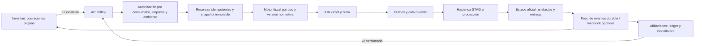
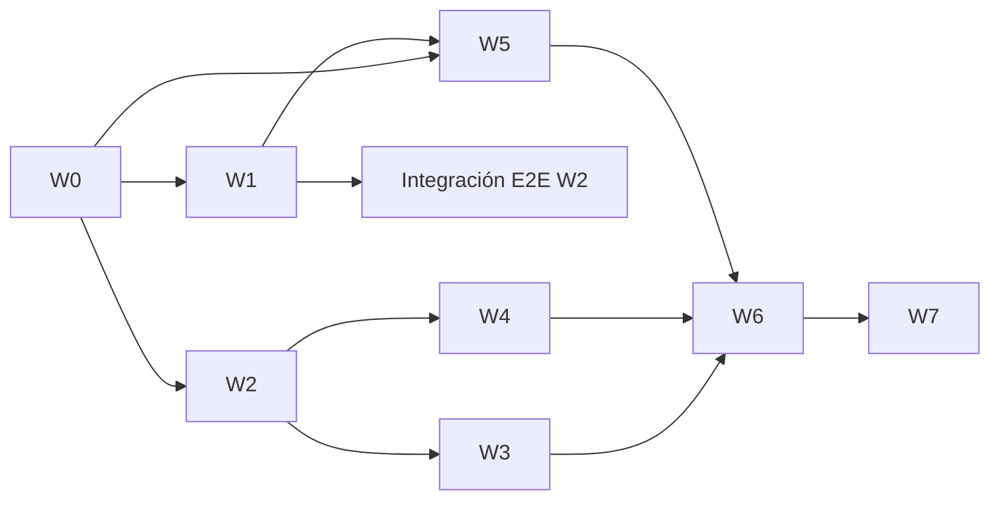

# SDD maestro — cierre funcional de Billing

**Estado:** diseño maestro con W0 ejecutado; no autoriza W1, migraciones reales, STAG ni despliegue.
**Corte:** 27 de octubre de 2026, `HEAD 9983368`, árbol de trabajo con cambios preexistentes.
**Fuentes principales:** [inventario](billing-capability-audit.md), [brechas](billing-gap-analysis.md), [integración](billing-affiliations-integration.md), [roadmap](billing-completion-roadmap.md) y [preparación productiva](billing-production-readiness.md). El estado auditado se conserva como línea base, aunque una prueba posterior mejore su evidencia. Las rutas y modelos citados abajo se contrastaron con el árbol actual.

## 1. Alcance, principios y evidencia

Billing seguirá siendo el servicio fiscal API-first y multiempresa. Inventori y el sistema nuevo de afiliaciones tendrán identidades M2M, permisos, claves y referencias comerciales independientes. Billing será dueño de configuración del emisor, numeración/clave, snapshot fiscal, XML, firma, envío, estado oficial, documentos correctivos, artefactos y entrega. Cada consumidor será dueño de sus ventas/obligaciones, aplicaciones de pago, saldos y decisión de qué hecho fiscal solicita. No habrá base de datos, modelos de negocio ni credenciales compartidas entre aplicaciones, conforme al ADR-010 existente en `specs/fase-0-foundation/decisions.md`.

La línea base auditó **54 capacidades: 13 `COMPLETE_VERIFIED`, 12 `IMPLEMENTED_UNVERIFIED`, 14 `PARTIAL`, 12 `MISSING`, 2 `BLOCKED` y 1 `NOT_APPLICABLE`**. `COMPLETE_VERIFIED` significa evidencia suficiente para el alcance descrito en la auditoría; no autoriza producción. Este SDD no convierte automáticamente una capacidad a otro estado. Cada cambio futuro exige actualizar evidencia y matriz en un PR.

La fuente normativa revisada es el [Decreto 44739-H](https://www.hacienda.go.cr/docs/REGLAMENTO_DE_COMPROBANTES_ELECTRONICOS.pdf), los [Anexos y Estructuras v4.4](https://www.hacienda.go.cr/docs/ANEXOS_Y_ESTRUCTURAS_V4.4.pdf), la [comunicación de actualización 2026](https://www.hacienda.go.cr/docs/ActualizacionAnexosyEstructurasVersion4.4CEv2.pdf) y la [API de recepción de Hacienda](https://www.hacienda.go.cr/docs/ComprobantesElectronicosAPI.html). El reglamento distingue un documento válido corregido mediante NC/ND de uno rechazado que carece de validez. La comunicación anuncia nuevos códigos de referencia con exigibilidad desde el 1 de noviembre de 2026. El equipo fiscal debe verificar la versión oficial aplicable en la fecha de cada liberación; este documento no dictamina si una cuota concreta está exenta ni cuándo ocurre su hecho generador.

## 2. Contraste del diseño con el código actual

| Hallazgo verificable | Implicación de diseño |
|---|---|
| `prisma/schema.prisma`: `FiscalDocumentType` solo `INVOICE` y `TICKET`; `FiscalSequence.documentType` usa ese enum | NC, ND, REP, FEE y FEC requieren modelo, numeración, XML/XSD, firma, envío, PDF y entrega, no un endpoint aislado |
| `FiscalIntegrationAssociation.companyId @unique`; `FiscalOnboardingV1Service` fija `provider: INVENTORI`; `IntegrationProfileGuard` acepta solo `inventori-fiscal-v1` | Una misma empresa no puede asociarse a dos consumidores con el modelo actual. Diseñar asociación v2 plural sin alterar la relación histórica de Inventori |
| `FiscalIdempotencyKey` tiene unicidad `(tenantId, companyId, operation, key)`; `apiKeyId` es metadato, no parte del namespace | Dos consumidores de la misma empresa pueden colisionar si usan igual clave/operación. Diseñar namespace v2 por consumidor conservando recuperación tras rotación |
| `ApiKeyCompany` es N:M; `ApiKeyAuthGuard` comprueba empresa y mapea TEST→SANDBOX/LIVE→PRODUCTION | Restringir la nueva clave operativa a una empresa, ambiente y perfil en alta; verificar rutas por ID que omiten `companyId` |
| `CreateFiscalLineDto` tiene un impuesto escalar; `CreateFiscalDocumentDto` admite CRC/USD; `validateReceiver` exige identificación numérica y correo FE | Líneas v2 necesitan tratamiento e impuestos explícitos; extranjero, otros tributos y divisas requieren contratos y reglas separados |
| `fiscal-payload-equivalence.v1` canoniza campos fiscales y preserva hashes históricos cuando faltan campos opcionales | v2 debe tener su propio hash/vector. Nunca recalcular ni reescribir reservas o snapshots v1 |
| `Xsd11ValidatorAdapter` lanza Python; PDF real escribe `test-output/pdf`; CI usa Python 3.12 y PostgreSQL descartable | Una falla en un sandbox de ejecución puede impedir pruebas sin implicar XML inválido. El gate exige repetición en ambiente apto y clasificación por causa |
| `.github/workflows/ci.yml` fija un cliente Inventori en un commit; `docs/contracts/` tiene onboarding y lookup, no ciclo fiscal completo | Ampliar fixtures y pruebas de contrato sin modificar el cliente actual; mantener matriz de compatibilidad por versión y commit |

## 3. Arquitectura objetivo



### Límites de datos

1. **Identidad del emisor:** `tenantId`, `companyId`, ambiente y punto de emisión son ámbito autenticado. `consumerId` deriva de la credencial M2M; el caller no elige su propio namespace. Un emisor legal puede ser usado por ambos sistemas **solo si el dueño confirma esa topología** y cada aplicación tiene asociación y clave propias. Los documentos v2 llevan `originConsumerId`; lectura, artefactos, correcciones y eventos se filtran también por ese origen, salvo rol fiscal administrativo explícito. El guard v1 debe negar acceso a documentos v2 de otro consumidor sin cambiar la lectura de documentos v1 históricos.
2. **Integración plural:** proponer `FiscalConsumerAssociation` v2, única por `(tenant, provider, externalCompanyKey)` y `(tenant, company, consumerId)`, manteniendo `FiscalIntegrationAssociation` v1 sin cambio destructivo. La migración exacta se diseña y ensaya después de aprobar el ADR. La lectura v1 conserva el comportamiento Inventori.
3. **Idempotencia v2:** reserva separada o índice nuevo con `(tenant, company, environment, consumerId, operation, key)` y hash canónico v2. La opción preferida es tabla v2 nueva para preservar semántica y datos históricos v1. Clave rotada mantiene `consumerId`; una clave revocada no puede operar. `externalOperationId` del consumidor es evidencia adicional, no sustituto de `Idempotency-Key`.
4. **FiscalIntent:** el nuevo sistema persiste antes de llamar a Billing el hecho comercial, asignaciones, versión tributaria, receptor, líneas y hash. Billing devuelve identidad/estado fiscal; no calcula períodos ni saldos. Las referencias comerciales v2 son metadatos inmutables y verificables, separados de nodos XML; la descripción fiscal visible incluye concepto y período cuando corresponda.
5. **Documento correctivo:** referencia al comprobante original aceptado y mantiene original inmutable. Cada NC/ND tiene su propia clave, consecutivo, snapshot, estados y artefactos. Una reserva transaccional del importe corregible impide sobrecorrección concurrente, y distingue notas pendientes, aceptadas y rechazadas.
6. **Eventos:** un outbox transaccional publica cambios posteriores al commit. Un feed autenticado con cursor es la vía canónica de replay; webhook firmado es transporte opcional. Estado del documento, envío y entrega permanecen distintos.

## 4. Matriz de trazabilidad de las 54 capacidades

`I` = implementación nueva, `P` = completar implementación parcial, `V` = verificar lo existente, `D` = decisión o gate externo, `N/A` = fuera de Billing. La columna **base** preserva exactamente el estado del inventario; la clasificación de trabajo muestra lo que debe hacerse a continuación. `W` remite a las waves de la sección 8. `W6`/`W7` son validación STAG/autorización productiva, no código. La verificación de un componente puede repetirse en varias waves sin duplicar su capacidad.

| ID | Base | Trabajo | Wave primaria | Salida verificable |
|---|---|---|---|---|
| C01 | COMPLETE_VERIFIED | V | W0 | aislamiento tenant/empresa en regresión |
| C02 | COMPLETE_VERIFIED | V | W0 | perfil fiscal v1 intacto |
| C03 | IMPLEMENTED_UNVERIFIED | I | W1 | asociación plural y consumerId probado |
| C04 | COMPLETE_VERIFIED | V | W0 | consulta fiscal y fallos externos reproducibles |
| C05 | COMPLETE_VERIFIED | V | W0 | actividad por emisor y ambiente |
| C06 | IMPLEMENTED_UNVERIFIED | V | W0 | ciclo M2M de sucursal/terminal y secuencia |
| C07 | COMPLETE_VERIFIED | V | W0 | concurrencia y procedencia de migración |
| C08 | COMPLETE_VERIFIED | V | W1 | readiness revalidado antes de asignar clave |
| C09 | COMPLETE_VERIFIED | V | W0 | credenciales por emisor/ambiente sin exposición |
| C10 | COMPLETE_VERIFIED | V | W0 | certificado, identidad, rotación y custodia |
| C11 | PARTIAL | P | W1 | matriz negativa tenant/empresa/ambiente/consumerId |
| C12 | IMPLEMENTED_UNVERIFIED | P | W1 | alta, rotación y revocación de perfil afiliaciones |
| C13 | COMPLETE_VERIFIED | V | W2 | FE gravada sin regresión v1 |
| C14 | IMPLEMENTED_UNVERIFIED | V | W6 | TE aceptado en STAG si aplica |
| C15 | MISSING | I | W3 | NC total referenciada y aceptada |
| C16 | MISSING | I | W3 | NC parcial con límite acumulado |
| C17 | MISSING | I | W3 | ND referenciada y aceptada |
| C18 | MISSING | D/I | W4 | decisión de aplicabilidad y FEC si corresponde |
| C19 | MISSING | D/I | W4 | decisión exportación y FEE si corresponde |
| C20 | MISSING | D/I | W4 | dictamen REP y contrato si corresponde |
| C21 | MISSING | D/I | W4 | rol receptor y mensajes si corresponde |
| C22 | COMPLETE_VERIFIED | V | W2 | IVA gravado y resumen regresión |
| C23 | PARTIAL | P/D | W2 | exento técnicamente válido y fundamento por emisor |
| C24 | MISSING | I/D | W2 | no sujeto/0 % si caso real y regla aprobada |
| C25 | MISSING | I/D | W2 | exoneración con soporte y sumas si aplica |
| C26 | PARTIAL | P/D | W2 | impuestos múltiples requeridos por emisores |
| C27 | PARTIAL | P/D | W2 | CABYS vigente y aptitud por concepto |
| C28 | IMPLEMENTED_UNVERIFIED | V | W0 | XSD/importe/descuento en ambiente apto |
| C29 | MISSING | D/I | W2 | política de precio incluido o normalización externa |
| C30 | PARTIAL | P | W2 | matriz exacta de redondeo y conciliación |
| C31 | PARTIAL | P/D | W2 | tasa congelada y monedas del alcance |
| C32 | MISSING | D/I | W4 | contrato extranjero y exportación si procede |
| C33 | IMPLEMENTED_UNVERIFIED | P/V | W0/W2 | XSD oficial vigente, hash y pipeline completo |
| C34 | COMPLETE_VERIFIED | V | W2 | firma por tipo/certificado en regresión |
| C35 | COMPLETE_VERIFIED | V | W6 | evidencia STAG por tipo; no inferir de FE |
| C36 | IMPLEMENTED_UNVERIFIED | V | W5/W6 | GET/callback real y reconciliación |
| C37 | PARTIAL | P | W3 | reemplazo rechazado sin NC ni doble cobro |
| C38 | COMPLETE_VERIFIED | V/P | W1 | v1 intacto y namespace v2 tras rotación |
| C39 | PARTIAL | P | W5 | recuperación duradera tras caída y POST ambiguo |
| C40 | IMPLEMENTED_UNVERIFIED | V | W5 | XML/respuesta y hashes restaurados |
| C41 | IMPLEMENTED_UNVERIFIED | V | W0/W5 | PDF local verificable y cobertura por tipo |
| C42 | IMPLEMENTED_UNVERIFIED | V | W5 | entrega, rebote y reenvío real |
| C43 | MISSING | I | W5 | feed durable y webhook firmado opcional |
| C44 | PARTIAL | P | W5 | auditoría, retención y atribución por consumidor |
| C45 | PARTIAL | P | W1–W5 | OpenAPI/fixtures versionados por operación |
| C46 | PARTIAL | V/P | W0 | suite reproducible, fallas clasificadas |
| C47 | IMPLEMENTED_UNVERIFIED | V | W0 | E2E DB descartable en CI/host apto |
| C48 | IMPLEMENTED_UNVERIFIED | V | W6 | evidencia FE STAG reproducible/conservada |
| C49 | BLOCKED | D/V | W6 | aceptación por cada tipo y escenario aplicable |
| C50 | BLOCKED | D | W7 | autorización productiva por artefacto/emisor |
| C51 | PARTIAL | P | W5 | restore DB/artefactos/secretos y RPO/RTO |
| C52 | PARTIAL | P | W5 | métricas, alertas y runbooks operados |
| C53 | PARTIAL | P/V | W0/W7 | CI y migraciones reconciliadas por checksum |
| C54 | NOT_APPLICABLE | N/A | — | ledger comercial permanece en consumidor |

**Cobertura:** C01–C54 aparecen una vez. La fila `D/I` indica que implementar el tipo está condicionado a una decisión de aplicabilidad; no convierte la ausencia técnica en `NOT_APPLICABLE` retrospectivamente.

## 5. Registro de decisiones y requisitos

### Decisiones fiscales que deben preceder a código tributario

| ID | Pregunta y evidencia necesaria | Dueño de decisión | Bloquea |
|---|---|---|---|
| DF-01 | ¿Cuáles conceptos de cada emisor son cuotas/mensualidades exentas y con qué fundamento, CABYS y código de transacción? No extrapolar la decisión histórica de una Cámara a otro emisor | Responsable tributario del emisor; aprobación de producto del alcance | C23,C27; W2, W6 |
| DF-02 | ¿Cuál es el hecho generador y documento para período devengado, cobro al contado, crédito, pago parcial, anticipo y excedente? Determinar si y cuándo aplica REP | Responsable tributario; dueño comercial | C20,C29,C30; W2–W4 |
| DF-03 | ¿Qué tratamientos 0 %, no sujeto, exonerado u otros impuestos aplican a cada plan/emisor? Exigir soporte de exoneración y regla de vigencia | Responsable tributario | C24–C26; W2 |
| DF-04 | ¿Cuándo un servicio a receptor extranjero es exportación y requiere FEE, qué identificación y tasa de cambio se aceptan? | Responsable tributario | C19,C31,C32; W4 |
| DF-05 | ¿El emisor debe emitir FEC/confirmaciones por su rol de receptor? ¿Qué condiciones de FE frente a TE aplican? | Responsable tributario | C14,C18,C21; W4/W6 |
| DF-06 | Confirmar versión normativa y catálogos efectivos al día de liberación, incluyendo referencias 12–17 y 19–20, XML/XSD por tipo y transiciones de versiones previas | Responsable tributario + operador de Hacienda | C15–C21,C33,C49; W2–W6 |

**Regla de diseño:** los códigos fiscales y la categoría tributaria se guardan explícitos en un snapshot aprobado; Billing valida consistencia y formato, no deduce exención, exportación o REP a partir de `taxAmount=0`, moneda, país o forma de pago.

### Decisiones de producto y operación para aprobación del usuario

| ID | Decisión solicitada | Propuesta técnica para evaluar | Efecto si queda pendiente |
|---|---|---|---|
| DP-01 | Alcance del primer emisor y si Inventori y afiliaciones compartirán una misma `Company` legal en Billing | Soportar ambos consumidores en una empresa y también empresas distintas, con asociaciones/credenciales separadas | No activar W1 para un emisor real |
| DP-02 | Granularidad de comprobante cuando un pago cubre varios períodos o afiliaciones | Una FE por hecho fiscal/emisor/receptor/moneda, con líneas y asignaciones independientes; excepciones documentadas | Bloquea fixtures y FiscalIntent de cobros múltiples |
| DP-03 | Qué escenarios de los 16 son requisito del primer lanzamiento, especialmente extranjero, crédito y pagos anticipados | No omitir reversos/correcciones si habrá facturas reales; clasificar otros por emisor y dictamen | Bloquea alcance de W2–W4 y gate W6 |
| DP-04 | Latencia y canal de avisos a consumidores | Feed durable autenticado como contrato base; webhook firmado opcional con SLA separado | No bloquea W0; afecta W5 |
| DP-05 | RPO/RTO, retención, custodia de respaldos y destinatario de alertas | Objetivos definidos por operación y comprobados con restauración | Bloquea W7 |

No se solicitan respuestas en este documento ni se presume aprobación. La validación normativa la debe dar un profesional autorizado por el emisor; la aprobación de alcance/producto no la sustituye.

### ADR propuestos

| ADR | Estado | Decisión propuesta y alternativas que debe resolver | Dueño / gate |
|---|---|---|---|
| ADR-BIL-011 Multi-consumidor | DRAFT | Asociación plural separada de `FiscalIntegrationAssociation` v1; evaluar migrarla en sitio solo si se prueba equivalencia histórica. ConsumerId estable, derivado de credencial | Arquitectura + dueño de integraciones; W1 |
| ADR-BIL-012 Idempotencia v2 | DRAFT | Nueva reserva con namespace de consumidor/ambiente frente a cambiar índice v1; preservar lookup histórico y rotación | Arquitectura + DBA; W1 |
| ADR-BIL-013 Contrato de líneas fiscales | DRAFT | v2 aditivo e inmutable, tratamiento/impuestos explícitos y hash v2; v1 queda congelado para Inventori | Arquitectura + fiscal; W2 |
| ADR-BIL-014 Documentos correctivos | DRAFT | Ledger correctivo por línea y referencia; reserva concurrente para notas pendientes, sin alterar original; rechazo ≠ NC | Arquitectura + fiscal; W3 |
| ADR-BIL-015 Eventos | DRAFT | Outbox + feed durable; webhook opcional firmado. Evaluar polling puro y costo/latencia | Arquitectura + producto/operación; W5 |
| ADR-BIL-016 Versión normativa | DRAFT | Paquete XSD/catálogos por tipo y vigencia, hashes e historial; política para notas sobre documentos de versión anterior | Fiscal + arquitectura; W2/W3 |
| ADR-BIL-017 Retención y recuperación | DRAFT | Conservación, backup y restauración conjunta DB/artefactos/secretos, RPO/RTO y claves separadas | Seguridad + operaciones + fiscal; W5/W7 |

Los ADR-002/003/006/008/009/010 de `specs/fase-0-foundation/decisions.md` siguen vigentes salvo decisión explícita y registrada. El addendum de reenvío M2M en `specs/fase-4-fiscal-artifacts-delivery/` se rotula propuesto, pero código/controlador de reenvío ya existen: la implementación actual y sus pruebas son la línea base, no el estado editorial del documento antiguo.

## 6. Contratos API versionados propuestos

Todos los paths de esta sección son **propuestos** bajo `/api/v2`; `/api/v1` y sus encabezados, respuestas e identidades persisten para Inventori. OpenAPI 3.1 y fixtures sintéticos serán artefactos de W1–W5. Las rutas de control administrativo requieren JWT `TENANT_ADMIN` o un rol operativo explícito; la clave ordinaria de cobros nunca administra secretos o secuencias. El `consumerId` no entra en URL/body de emisión: sale de la clave autenticada. `environment` debe coincidir con TEST/SANDBOX o LIVE/PRODUCTION. Todos los errores tienen cuerpo `{code, message, correlationId, retryable, details?}` sin datos secretos.

### 6.1 M2M y asociación

| Operación v2 | Autoridad | Solicitud/respuesta mínima | Semántica |
|---|---|---|---|
| `POST /integrations/consumers` | JWT `TENANT_ADMIN` | `{provider, externalCompanyKey, companyId, environment, profileVersion}` → `{consumerId, companyId, status}` | Crea/vincula asociación; misma solicitud devuelve identidad; conflicto si el par externo apunta a otra empresa |
| `POST /integrations/consumers/{consumerId}/keys` | JWT `TENANT_ADMIN` | `{environment, scopes, expiresAt}` → secret mostrado una vez + metadatos | Una empresa/ambiente; scopes sujetos a perfil; rotación no cambia consumerId ni reservas |
| `GET /integrations/consumers/{consumerId}` | JWT admin o scope `fiscal-consumer:read` | Asociación y claves sin secretos | No enumera otra empresa/tenant |
| `POST /integrations/consumers/{consumerId}/keys/{keyId}/revoke` | JWT admin | recibo de revocación | Revoca autoridad, no borra auditoría ni documentos |

La administración fiscal existente de `/api/v1/companies/{id}/fiscal-onboarding/v1/{environment}` queda accesible para Inventori bajo `inventori-fiscal-v1`. W1 decide qué lectura de readiness ofrece el perfil nuevo; escritura de credenciales/certificados requiere rol separado. `ApiKeyCompany` N:M no se modifica a ciegas: el servicio de alta v2 impone la vinculación unitaria y la verifica en DB/guard. Aunque dos consumidores usen el mismo emisor fiscal, uno no recibe la clave API del otro ni acceso operativo a sus documentos, asignaciones o eventos.

### 6.2 Línea fiscal y emisión v2

`POST /companies/{companyId}/fiscal-documents/{environment}/invoices` (y `/tickets` cuando se habilite) requiere `X-API-Key`, `invoices:create`/`tickets:create`, `Idempotency-Key` estable y `X-Fiscal-Payload-Contract-Version: fiscal-payload.v2`. Respuesta `201` al crear identidad local o `200` al replay idéntico; ambas retornan `documentId`, `clave`, `consecutive`, `documentStatus`, `submissionStatus`, `links`, `payloadHash` y `correlationId`. Estos estados no afirman aceptación de Hacienda. Un body fiscal distinto con la misma clave da `409 IDEMPOTENCY_PAYLOAD_CONFLICT` antes de numerar; timeout se resuelve por lookup v2.

Esquema conceptual (los códigos y reglas exactos requieren DF-01–DF-06 y XSD vigente):

```json
{
  "externalOperationId": "opaque-stable-id",
  "policyVersion": "issuer-approved-policy-id",
  "receiver": { "identificationType": "...", "identificationNumber": "...", "name": "..." },
  "currency": "CRC",
  "exchangeRate": null,
  "saleCondition": "01",
  "paymentMethods": [{ "code": "...", "amount": "..." }],
  "lines": [{
    "lineNumber": 1,
    "source": { "affiliationId": "opaque", "periodId": "opaque", "allocationId": "opaque" },
    "description": "Concepto y período fiscalmente pertinente",
    "cabysCode": "13-digit-code",
    "quantity": "1.00000",
    "unitPrice": "1000.00000",
    "priceInputMode": "EXCLUSIVE",
    "discounts": [],
    "taxTreatment": "TAXABLE",
    "taxes": [{ "code": "01", "rateCode": "08", "rate": "13.00000", "base": "1000.00000", "amount": "130.00000" }]
  }]
}
```

`source` es metadato comercial auditable que **no** se serializa como nodo fiscal inventado. El hash canónico v2 incluye `source`, política, orden de líneas, moneda, tasa e impuestos para detectar cambio de asignación; el servidor recalcula sumas con decimales exactos. Definir reglas de redondeo y total de medios de pago con el Anexo antes de fijar el esquema final. `priceInputMode=INCLUSIVE` solo se habilita con regla de descomposición aprobada; `EXCLUSIVE` no presupone IVA. Un esquema `taxTreatment` enumera intención declarada y exige códigos/documentos correspondientes; nunca transforma un 0 en exención por heurística. Campos no utilizados por un tipo se rechazan, no se ignoran silenciosamente.

### 6.3 Lectura, recuperación y estados

`GET /companies/{companyId}/fiscal-documents/{environment}/{type}/{documentId}` usa scope `{type}:read`. `GET .../operations/by-idempotency?operation=...&key=...` usa el namespace autenticado v2 y devuelve identidad solo si la evidencia canónica coincide. `GET .../{documentId}/submission`, `/artifacts`, `/deliveries` separan `documentStatus`, `submissionStatus`, `haciendaStatus` y `deliveryStatus`. Cursor/ETag y `Retry-After` hacen polling recuperable. `POST .../{documentId}/reconcile` queda como operación privilegiada/limitada; los GET no generan otro documento. `404` no revela tenants/empresas ajenas; `409` de integridad bloquea reemisión automática.

### 6.4 NC/ND y reemplazo de rechazado

`POST /companies/{companyId}/fiscal-documents/{environment}/credit-notes` y `/debit-notes` requieren scope `credit-notes:create`/`debit-notes:create`, `Idempotency-Key`, `sourceDocumentId`, `referenceReasonCode`, `reason`, `correctionLines[]` con `sourceLineNumber`, cantidad/base/impuesto/total exactos, y `externalCorrectionId`. La respuesta tiene identidad propia y `correctableBalance`/`reservedCorrectionAmount` seguros; el saldo definitivo cambia solo según resultado oficial. `GET/submit/reconcile/artifacts` siguen el mismo patrón por tipo. Toda nota valida emisor, ambiente, moneda, original aceptado, referencia normativa y límites por línea bajo bloqueo transaccional. Varias notas pendientes se reservan para impedir sobrecorrección; rechazo oficial libera o resuelve reserva con rastro auditable. Política de ND y códigos de referencia exactos requieren DF-06.

Un `REJECTED` del documento original usa `POST .../{documentId}/replacements` con causa y nueva idempotencia, sujeto a revisión/estado oficial; **no** crea NC. La respuesta enlaza reemplazo y original inválido sin reutilizar clave/consecutivo. Este contrato requiere pruebas de la transición `SUPERSEDED` ya presente y de no duplicar cobro.

### 6.5 Eventos

`GET /companies/{companyId}/fiscal-events?cursor=...&limit=...` con `fiscal-events:read` entrega eventos ordenados por secuencia durable, más `nextCursor`; permite replay después de caída. Envelope v1:

```json
{
  "eventId": "uuid",
  "sequence": "monotonic-per-company",
  "schemaVersion": "billing.fiscal-event.v1",
  "consumerId": "authenticated-consumer",
  "companyId": "uuid",
  "environment": "SANDBOX",
  "documentId": "uuid",
  "documentType": "INVOICE",
  "eventType": "fiscal.document.accepted",
  "occurredAt": "ISO-8601",
  "correlationId": "opaque-id",
  "data": { "clave": "50-digit-key", "haciendaStatus": "ACCEPTED" }
}
```

Eventos mínimos: `created`, `submission.uncertain`, `accepted`, `rejected`, `manual_review`, `corrected`, `delivery.failed`, `delivery.completed`. Un webhook opcional reutiliza el envelope, usa HMAC con `keyId`/timestamp/firma o mTLS, deduplica por `eventId`, reintenta con backoff y permite replay por feed; nunca expone XML, credenciales ni correo en payload. El consumidor procesa al menos una vez e idempotentemente; Billing no promete orden global entre empresas.

### 6.6 Compatibilidad Inventori

Congelar `/api/v1`, `inventori-fiscal-v1`, `fiscal-payload-equivalence.v1`, lookup v1/v2 actual, semántica de reservas existentes y fixtures. No exigir encabezados v2 en v1 ni reinterpretar `lines Json`/XML firmado históricos. Añadir pruebas de contrato con el cliente Inventori fijado en CI y fixtures de hashes conocidos; comparar respuestas/códigos en ambos lados. La migración de asociación/idempotencia nueva es aditiva, ensayada en PostgreSQL descartable con snapshot sanitizado y rollback de aplicación que no borra filas. Ninguna wave de este SDD edita Inventori sin su propia tarea y contrato aprobado.

## 7. Investigación de las 43 pruebas fallidas

El primer intento, dentro del sandbox del agente, obtuvo `106` suites aprobadas, `7` fallidas y `3` omitidas; `1.264` tests aprobados, `43` fallidos y `13` omitidos. No se clasificaron por intuición: se inspeccionaron los mensajes, el adaptador y la prueba de PDF, se ejecutó `python .../xmlschema-validator.py compile .../FacturaElectronica.xsd` directamente (`valid: true`), se reprodujo `spawnSync python EPERM` con `node:child_process` y luego se repitió **la misma suite y el mismo árbol de código** fuera de esa restricción. Resultado: **113 suites aprobadas, 3 omitidas; 1.307 tests aprobados, 13 omitidos, 0 fallidos**. La diferencia exacta es de 43 tests. La repetición no prueba STAG, red externa, PostgreSQL productivo ni tipos fiscales no implementados.

| Suite fallida inicialmente | Casos | Evidencia causal en primer intento | Repetición apta | Clasificación |
|---|---:|---|---|---|
| `prepare-fiscal-xml.service.spec.ts` | 3 | El servicio recibió `FISCAL_XML_VALIDATOR_FAILED` tras `spawnSync python EPERM` | PASS | Entorno, subproceso XSD |
| `billing-default-v1-real-pdf.spec.ts` | 8 | `EPERM open` en `test-output/pdf`; otras 29 pruebas de la misma suite pasaron | PASS | Entorno, escritura de artefactos de prueba |
| `node-xades-epes-signer.adapter.spec.ts` | 3 | Aserciones de XSD usaron el mismo adaptador bloqueado | PASS | Entorno, subproceso XSD |
| `inventori-p0-fiscal-compatibility.spec.ts` | 14 | Esperaba XSD válido; el adaptador devolvió fallo de ejecución | PASS | Entorno, subproceso XSD |
| `hacienda-v44-receiver-activity.spec.ts` | 2 | Aserciones XSD aguas abajo del adaptador | PASS | Entorno, subproceso XSD |
| `spec-00-medicine-xml.spec.ts` | 7 | Aserciones XSD aguas abajo del adaptador | PASS | Entorno, subproceso XSD |
| `xsd11-validator.adapter.spec.ts` | 6 | Salida inválida/fallo de proceso; incluso la prueba de timeout no pudo lanzar el proceso | PASS | Entorno, subproceso XSD |
| **Total** | **43** | **35 por ejecución de subproceso; 8 por escritura PDF** | **43 PASS** | **0 defectos funcionales demostrados por estas 43** |

**Límite:** el permiso ampliado cambió el entorno de ejecución, no el código. El resultado no descarta defectos fiscales no cubiertos. Es evidencia nueva para C28/C33/C41/C46, pero su estado auditado solo se cambia tras una actualización explícita de la matriz que distinga unidad, E2E y STAG. W0 debe hacer hermético el harness de Python/PDF y registrar en CI el ejecutable, versión `xmlschema`, directorio temporal, permisos y hashes de XSD; no debe esconder un fallo del validador como PASS ni saltar la prueba. El comando `npm run typecheck` inicial recibió `EPERM` al escribir `dist/tsconfig.tsbuildinfo`; `npx tsc --noEmit --incremental false` pasó. Los 13 tests omitidos siguen `NOT_RUN` y requieren análisis por riesgo antes del gate de producción.

## 8. Plan SDD por waves

Cada wave produce un paquete de diseño/implementación verificable y termina con su propio gate técnico. `LOCAL` es revisión y pruebas aisladas, `STAG` es interacción oficial autorizada en ambiente de pruebas y `PROD` es autorización/despliegue aparte. No se agrupan como un único PASS. La complejidad S/M/L/XL de la auditoría es relativa, sin calendario comprometido.

| Wave | Entrada y dependencia | Trabajo y capacidades | Salida técnica, pruebas y evidencia |
|---|---|---|---|
| **W0 — Baseline reproducible** | Repositorio actual; ninguna DF/DP pendiente para leer, documentar o probar | Congelar contrato v1, fixtures y hash; hacer reproducible suite/XSD/PDF en ambiente apto; inventariar XSD/anexos vigentes; contrastar 54 filas con código; reconciliar migraciones **solo en lectura o DB descartable**; C01,C02,C04–C07,C09,C10,C28,C33,C41,C46,C47,C53 | 1.307/1.307 tests no omitidos PASS en runner definido, causa de 13 omisiones documentada; E2E DB descartable y safety; matrices v1/Inventori y migración con hashes; ningún dato real modificado |
| **W1 — Identidad multi-consumidor** | W0 y ADR-BIL-011/012 aprobados; DP-01 define topología del primer emisor | Asociación plural, perfiles/keys v2, `originConsumerId`, autorización cruzada, reservas v2/lookup, OpenAPI/fixtures M2M; C03,C08,C11,C12,C38,C45 | API key de cada aplicación solo ve su origen/empresa/ambiente; rotación conserva identidad, revocación bloquea; replay idéntico y conflicto no asignan segundo consecutivo; E2E con dos consumidores y v1 intacto; migración aditiva ensayada |
| **W2 — Línea fiscal v2 y FE/TE** | W0; ADR-BIL-013/016; DF-01/02/03/06 para tratamientos que se implementen. Puede empezar diseño de contrato paralelo a W1; integración E2E requiere W1 | Motor fiscal por tratamiento, CABYS, descuentos, precio incluido si aprobado, monedas/tasa, XML/XSD/PDF FE/TE; C13,C22–C31,C33,C34 | Snapshot y hash v2 estables; sumas por línea/período correctas; XSD oficial actualizado, firma y PDF local; v1 Inventori regresión. STAG se registra en W6, no aquí |
| **W3 — Correctivos y rechazo** | W0, núcleo fiscal W2 y ADR-BIL-014/016; DF-06. Diseño/fixtures pueden prepararse durante W2 | NC total/parcial, ND, referencias, ledger corregible y sustitución del rechazado; C15–C17,C37 | Original inmutable; límites por línea con concurrencia y notas pendientes; `REJECTED` sin NC; pruebas unitarias, E2E DB descartable, XML/XSD/firma/PDF y errores contractuales. Aceptación oficial se difiere a W6 |
| **W4 — Tipos fiscales condicionados** | DF-02/04/05/06 determinan aplicabilidad y prioridad; reutiliza núcleo W2/W3 | REP, FEE, FEC, confirmaciones, extranjero y moneda del alcance; C18–C21,C32 | Para cada tipo aprobado: contrato, modelo, XML/XSD/firma/entrega y E2E propios; para cada tipo diferido: decisión firmada y restricción de producto. No declarar cobertura por FE |
| **W5 — Eventos y operación durable** | W1 para identidad/eventos; parte de backups, métricas y cola puede avanzar desde W0 en paralelo a W2–W4 | Outbox/feed, webhook opcional, recuperación, artefactos, entrega, auditoría, backups y alertas; C36,C39–C45,C51,C52 | Replay sin pérdida/duplicación visible; caídas DB/Hacienda/SMTP ensayadas; hashes restaurados y RPO/RTO medidos; alertas con dueño; pruebas de acceso por origen y retención |
| **W6 — STAG por escenario** | Gates LOCAL de tipos aplicables W2–W5, certificados/credenciales STAG, autorización de prueba y escenarios DF firmados | FE gravada/exenta, TE, NC/ND, REP/FEE/FEC/confirmaciones cuando apliquen; rechazo y recuperación; C14,C35,C36,C48,C49 | Por tipo/escenario: clave, hash XML, firma, POST, GET/callback, respuesta oficial terminal y artefactos sanitizados. `201/202` solo recepción; sin aprobación de tipo no hay PASS STAG |
| **W7 — Autorización de producción** | W0–W6 según alcance firmado; DP-05; migraciones/backups/imagen congelados | Gate de release, seguridad, custodia y observación controlada; C50,C53 | Aprobaciones de dueño de negocio, fiscal, seguridad y DBA/operación sobre digest, empresa, ventana y rollback; prueba de restore; despliegue y aceptación productiva se registran separadamente |

### Dependencias y paralelismo permitido



W0 es la **primera wave implementable sin decisiones fiscales ni aprobaciones de producto pendientes**. Tras W0, W1 y el diseño de W2 pueden avanzar en paralelo, pero la migración multi-consumidor espera ADR-BIL-011/012 y la integración E2E espera W1. El armazón de outbox/backup/observabilidad de W5 puede avanzar con W1/W2; eventos de NC/ND esperan W3. W4 es modular por tipo y se ejecuta solo para supuestos aprobados, mientras W3 no necesita REP/FEE/FEC. W6 nunca se sustituye con mocks o con una FE histórica; W7 nunca se deduce de W6.

## 9. Estrategia de pruebas y criterio de evidencia

| Nivel | Cobertura obligatoria | Evidencia almacenada |
|---|---|---|
| Contrato | OpenAPI v1/v2, fixtures por endpoint, códigos de error, versión/hash, replay de idempotencia; cliente Inventori fijado en CI y cliente de afiliaciones sintético | Diff de schemas, fixture con hash, resultado de consumidor/proveedor por commit |
| Unidad | Aritmética decimal, impuesto por tratamiento, descuento, redondeo, referencias, saldo correctivo, canonicalización v1/v2, firma de evento y transiciones | Nombre de suite, casos y resultado; no pruebas que solo repliquen implementación |
| Integración DB | Dos tenants, dos empresas, dos consumidores misma empresa, ambientes TEST/LIVE, key rotada/revocada; reservas concurrentes, consecutivos, NC simultáneas, outbox | PostgreSQL descartable y migración ensayada; ninguna DB real |
| XML/XSD/firma/PDF | XSD oficial por tipo y vigencia, firma verificable, XML y resumen reconciliados, PDF legible y fiel, XML histórico v1 sin cambio | XSD SHA-256, XML/PDF sintéticos, validación de firma y comparaciones de campos |
| E2E API/worker | Alta M2M, readiness, emisión, submit, consulta, callback/polling, entrega, reenvío, recuperación tras restart/partición | Log sanitizado con correlation ID; mocks para Hacienda/SMTP en CI |
| STAG Hacienda | Cada documento aplicable y escenario fiscal representativo, respuesta terminal, rechazo controlado y reconsulta tras resultado ambiguo | Clave, tipo, emisor/ambiente, hash XML, fecha, respuesta oficial sanitizada, operador; no secretos |
| Seguridad/operación | IDOR y aislamiento por origen, secretos/PII, rate limits, callback, eventos, backup/restore, métricas y alertas | Informe de pruebas negativas, restore y runbook ejercitado |

### Matriz mínima de escenarios

Usar los 16 escenarios de `billing-affiliations-integration.md` con identificador estable. Para cada uno registrar `(emisor, concepto, período, allocationId, tratamiento, CABYS, base, descuento, impuesto, total, documento, estado, referencia)`. Casos 1–2: exento y gravado. Casos 3–8: pagos uno/múltiples/parciales/anticipos/excedentes, sin inferir documento antes de DF-02. Casos 9–11: cancelación y NC/ND total/parcial. Casos 12–14: rechazo, interrupción y reenvío. Casos 15–16: extranjero y divisas. Todo caso fuera de alcance debe tener DF/DP y restricción explícita, no una prueba omitida sin explicación.

**Gates por nivel:** `PASS LOCAL` requiere código+pruebas reproducibles con commit y entorno; `PASS STAG` requiere respuesta oficial por tipo/escenario; `PROD AUTH` requiere aprobación y despliegue exactos. El `readyToIssue` técnico y un `202` de recepción no satisfacen aceptación fiscal. La única FE histórica aceptada en STAG es evidencia de ese caso, no de TE/exento/notas/REP ni de la versión futura del código.

## 10. Riesgos, dependencias y mitigación

| Riesgo | Señal concreta | Mitigación y gate |
|---|---|---|
| Ruptura de Inventori | v1 usa DTO/hash/índices de idempotencia propios y cliente CI fijado | v2 aditivo; golden fixtures y E2E de Inventori antes de cada merge |
| Asociación unitaria oculta | `companyId @unique` en `FiscalIntegrationAssociation` | ADR plural y migración aditiva; dos consumidores misma empresa en E2E |
| Colisión de operaciones entre apps | unicidad v1 no contiene consumerId ni ambiente | reserva v2 separada; tests de claves iguales y rotación |
| Visibilidad cruzada | `ApiKeyCompany` N:M y rutas v1 por documentId | `originConsumerId`, autorización en cada lectura/artefacto/evento y pruebas de 404/403 |
| Impuesto o momento fiscal incorrecto | exento `01/10` local, pero elegibilidad y devengo sin dictamen general | DF-01–DF-06; política firmada y versionada en FiscalIntent |
| Corrección excesiva | múltiples notas parciales simultáneas | ledger por línea y reserva transaccional; E2E concurrencia y reversión de rechazo |
| Cambio de anexo/código | comunicación 2026 altera referencias; dos XSD locales | paquete oficial con hash/vigencia, fixtures por versión y vigilancia normativa |
| Migración con deriva | informe `wave2-security-release-candidate.md` observa historial distinto del árbol; archivos `202611*` posteriores al corte | inventario de checksums en solo lectura, restore descartable y gate DBA antes de tocar producción |
| Evidencia de pruebas falsa | sandbox local bloqueó Python/PDF; tests omitidos | runner hermético y CI, registrar `NOT_RUN` y causa; nunca convertir EPERM en aceptación |
| POST ambiguo o SMTP incierto | `POST_OUTCOME_UNKNOWN`, cola durable y reenvío | reconsulta por clave/idempotencia, outbox, manual review y simulacro de caída |
| Pérdida de artefactos/secretos | DB, XML, respuesta, PDF y key cifrada pueden divergir | backup/restauración conjunta, hash y custodia separada, RPO/RTO aprobado |

## 11. Checklist de producción por emisor y versión

Marcar cada elemento con enlace a evidencia, commit/digest, ambiente, fecha y responsable; sin esa evidencia queda `PENDING`.

- [ ] DF-01–DF-06 aplicables firmadas; DP-01–DP-05 resueltas para el alcance y emisor.
- [ ] `Company`/actividad/punto/secuencia/credenciales/certificado correctos para el ambiente; clave M2M propia de cada consumidor, rotación y revocación ensayadas.
- [ ] Normativa, catálogos y XSD vigentes fijados por hash; política para correcciones de comprobantes antiguos.
- [ ] `/api/v1` Inventori sin regresión y `/api/v2` con OpenAPI/fixtures/errores versionados; aislamiento cruzado y PII/secretos revisados.
- [ ] Todas las suites no omitidas PASS en CI y E2E descartable; omisiones justificadas/cerradas; XML/XSD/firma/PDF de cada tipo aplicable.
- [ ] STAG oficial por FE gravada/exenta, TE, NC/ND y tipos condicionales aplicables; respuesta terminal archivada, no solo recepción.
- [ ] Rechazo, POST ambiguo, reinicio y NC parcial concurrente recuperados sin segunda clave ni pérdida de saldo.
- [ ] Entrega y reenvío con proveedor real; feed/webhook con replay, firma, alertas y operador designado.
- [ ] DB/objetos/secretos respaldados, restaurados y conciliados; RPO/RTO y plan de contingencia aprobados.
- [ ] Migraciones/checksums objetivo conciliados en restore; imagen API/worker por digest, SBOM y dependencia/runtime auditados.
- [ ] Aprobaciones separadas de negocio, responsable fiscal, seguridad y DBA/operaciones para **esa** empresa, imagen, ambiente y ventana.
- [ ] Activación/canary y observación productiva autorizadas; aceptación real productiva se registra como hecho posterior, no como supuesto del gate.

## 12. Tareas ejecutables para agentes de Codex

Son prompts de ejecución futura; **no se despachan ni se implementan con este SDD**. Cada tarea modifica únicamente su ámbito cuando el usuario autorice la implementación. Las tareas que toquen migraciones usan DB descartable hasta W7 y ninguna transmite a Hacienda sin autorización de escenario.

| Tarea | Wave / dependencias | Ámbito concreto para el agente | Definición de terminado |
|---|---|---|---|
| T00 Reproducir baseline | W0, libre | Revisar `package.json`, `xsd11-validator.adapter.ts`, prueba PDF y CI; fijar runner Python 3.12/xmlschema, rutas temporales y salida de pruebas sin silenciar errores | Suite completa y E2E descartable con logs resumidos, hashes/versión y 13 omisiones clasificadas; v1 sin cambio |
| T01 Congelar contratos v1 | W0, libre | Inventariar endpoints, scopes, errores y golden fixtures de `docs/contracts/`, cliente Inventori fijado y hash fiscal v1 | Matriz proveedor/consumidor y prueba que falla si cambia contrato v1 sin versión |
| T02 Reconciliar esquema | W0, libre | Comparar `prisma/migrations`, schema y registro aplicado **en solo lectura**; diseñar ensayo sobre restore descartable | Tabla checksum/orden/desvío, plan seguro DBA; ninguna migración productiva |
| T03 Asociación plural | W1, T01/T02 + ADR-011/DP-01 | Diseñar/implementar `FiscalConsumerAssociation` y API admin v2, preservando v1 | E2E dos consumidores misma empresa y empresas distintas; rollback de aplicación ensayado |
| T04 Namespace idempotente v2 | W1, T03 + ADR-012 | Reserva por consumidor/ambiente, hash v2 y lookup/replay; no modificar reservas v1 | Concurrencia, misma key entre apps, rotación, conflicto y timeout probados |
| T05 Autorización v2 | W1, T03 | `originConsumerId` y controles en emisión, lectura por ID, XML, artefactos, notas y feed; scopes mínimos | Matriz negativa completa y v1 histórico intacto |
| T06 Esquema línea fiscal | W2, T01 + ADR-013 + DF-01–03/06 | OpenAPI/fixtures v2, tratamiento/impuestos, base/descuento, precio y tasa congelada; implementar solo tratamientos aprobados | Sumas deterministas, XSD/firma/PDF, regresión FE/TE v1 y casos 1–8 aprobados |
| T07 Catálogo normativo | W2, T00 + ADR-016/DF-06 | Obtener paquete oficial vigente, fijar hash/vigencia por XSD/catálogo y adaptar validador por tipo | Tests de versión, referencias y documentos históricos, sin descargar en runtime |
| T08 NC/ND y ledger | W3, T06/T07 + ADR-014 | Modelo, API, referencias, reserva correctiva transaccional, XML/PDF/entrega | NC total/parcial, ND, múltiples notas concurrentes y casos 9–11 en E2E; original intacto |
| T09 Reemplazo rechazado | W3, T08 para núcleo de referencia, DF-06 | Contrato `replacements`, estados y reconciliación sin NC | Caso 12: nueva identidad, causa y vínculo; ningún doble cobro/clave reutilizada |
| T10 Tipos condicionales | W4, T06/T07 + DF-02/04/05 | Un subpaquete por REP, FEE, FEC o confirmaciones declarado aplicable | XSD/firma/PDF/E2E del tipo; tipos diferidos documentados con restricción |
| T11 Outbox y feed | W5, T03/T05 + ADR-015/DP-04 | Outbox DB, feed con cursor, webhook opcional y replay | Pruebas de commit/caída/replay/firma/aislamiento y eventos de W3 una vez disponibles |
| T12 Resiliencia operativa | W5, T00 y luego T08/T11 | Recuperación worker, artefactos, correo, backup/restore, métricas/alertas | Simulacro DB/Hacienda/SMTP, RPO/RTO medidos, runbooks y hashes intactos |
| T13 Evidencia STAG | W6, gates LOCAL y autorización externa | Ejecutar escenarios por tipo y emisor con credenciales STAG, conservar respuestas sanitizadas | `PASS STAG` por caso, rechazo y recuperación incluidos; sin producción |
| T14 Release productivo | W7, todos los gates aplicables y aprobaciones | Preparar digest, migraciones ensayadas, backup, canary y rollback | Registro de autorizaciones y resultados productivos; nunca inferido de STAG |

**Registro de ejecución W0 (2026-10-27):** T00, T01 y T02 se ejecutaron en `codex/billing-w0` desde `9983368dd255e36438295e63a5a3be53a8308996`, sin incorporar los cambios fiscales locales del checkout original. El cierre técnico se documenta en `docs/operations/billing-w0-technical-evidence.md`; el inventario de 42 pares verbo/ruta Inventori y sus hashes en `docs/contracts/inventori-v1-inventory-w0.md`; la reconciliación de 24 migraciones, sus checksums y el diff de 16 tablas en `docs/operations/billing-w0-schema-reconciliation.md`. La suite propia de la rama pasó 1.297 pruebas y omitió 13 por condiciones de infraestructura; esas 13 se ejecutaron en PostgreSQL/LocalStack descartables y pasaron. E2E con cliente Inventori fijado: 153/153. El conteo auditado de 1.307 pertenece al árbol original con cambios locales adicionales y no se atribuye a esta rama.

| Tarea W0 | Cierre técnico | Trazas de capacidades | Límite |
|---|---|---|---|
| T00 | PASS: XSD/Python y PDF reales, unitarias, 12 DB, 1 SSM, safety y typecheck | C28, C33, C41, C46, C47 | No acredita XSD vigente ni STAG por tipo. |
| T01 | PASS: 42 pares cliente fijado, OpenAPI/fixtures con hash, lock de rutas/guardas/scopes y E2E cliente real | C01, C02, C04–C07, C09, C10 | No equivale a probar cada ruta en producción. |
| T02 | PASS CON DIVERGENCIAS DOCUMENTADAS: 24 checksums y cero pendientes en DB descartable; diff Prisma de 16 tablas | C53 | DBA debe revisar diff y releer la base normal antes de DDL. |

**Estado W0: `W0_TECHNICAL_PASS` local.** Es un cierre de ingeniería bajo los criterios de W0, no un gate STAG ni una autorización de producción. El diseño de W1 puede prepararse con las decisiones explícitamente marcadas como propuestas; su implementación operativa espera ADR-BIL-011/012 y DP-01. Cualquier migración o integración real de W1 espera además revisión DBA del diff y preflight de la base objetivo. El diseño de contratos W2 puede prepararse en paralelo, sujeto a sus decisiones fiscales. No se ejecutó W1.

**Registro de diseño W1 (2026-10-27):** [diseño técnico propuesto](docs/design/billing-w1-technical-design.md), [matriz de compatibilidad v1/v2](docs/design/billing-w1-compatibility-matrix.md), [plan de revisión DBA](docs/design/billing-w1-migration-plan.md), [OpenAPI M2M v2 propuesto](docs/contracts/billing-consumers.v2.proposed.openapi.yaml) y [OpenAPI de intención fiscal W2 propuesto](docs/contracts/billing-fiscal-intent.v2.proposed.openapi.yaml). Son artefactos de diseño: ADR-BIL-011/012 y DP-01 conservan su estado pendiente, y no se activó `/api/v2`.

**Registro de W1-D0 (2026-10-27):** [evidencia técnica](docs/operations/billing-w1-d0-technical-evidence.md) y [consultas DBA preparadas en solo lectura](docs/operations/billing-w1-d0-dba-readonly.sql). Fixtures sintéticos, contratos v2 propuestos, lock de 42 pares v1, prefijo v1/v2 y regresiones terminaron `W1_D0_TECHNICAL_PASS` local. La base objetivo no se consultó por falta de conexión autorizada; T03–T05 operativos, DDL, STAG y producción siguen pendientes.

**Preparación W1-D1 (2026-10-27):** [matriz de decisiones, gates y tareas](docs/design/billing-w1-d1-decision-readiness.md), [ADR-BIL-011 para aprobación](docs/design/adr-bil-011-w1-d1-for-approval.md), [ADR-BIL-012 para aprobación](docs/design/adr-bil-012-w1-d1-for-approval.md) y [DP-01 para aprobación](docs/design/dp-01-w1-d1-for-approval.md). Son propuestas finales revisables; las decisiones no se marcan aprobadas y W1-D1 no se ejecutó.

**W1-D1 fase sin DDL (2026-10-27):** [políticas, DTO, contratos propuestos y matriz de evidencia](docs/operations/billing-w1-d1-no-ddl-technical-evidence.md). Se aplicaron los criterios ADR-BIL-011/012 solo al diseño y pruebas aisladas de T03–T05; la aprobación formal de ambos ADR y DP-01 sigue pendiente. No hay alta M2M v2, reserva persistente, ruta v2 operativa, DDL, cambio fiscal ni autorización de producción.

**W1-D2 laboratorio aislado (2026-10-27):** [evidencia de persistencia, migración y guard M2M v2](docs/operations/billing-w1-d2-lab-technical-evidence.md) para T03–T05. La nueva migración y las pruebas DB se aplican solo en PostgreSQL descartable; `AppModule` no registra rutas v2. Los ADR-BIL-011/012, DP-01, revisión DBA de las 16 divergencias, STAG y producción siguen pendientes.

**W2-B, corte de laboratorio (2026-10-27):** el usuario autorizó W2-B exclusivamente en laboratorio; esa autorización no aprueba decisiones fiscales ni activa producción. La [proyección fiscal sintética y sus límites](docs/design/billing-w2-b-lab-projection-decision.md) y la [evidencia W2-B](docs/operations/billing-w2-b-lab-evidence.md) avanzan T06/C13,C22–C31,C33,C34 sin activar rutas. Los escenarios gravado, exento y mixto acreditan únicamente representación aritmética/XML/XSD/XAdES bajo datos sintéticos; no autorizan la clasificación tributaria de un emisor. La reserva fiscal persistente, el enlace documental v2, pagos múltiples, múltiples impuestos/descuentos por línea y los dictámenes ADR-BIL-013/016, DP-02 y DF aplicables permanecen pendientes. W2-B no supera su gate de motor fiscal completo mientras esas dependencias no estén cerradas.

**W2-B2, continuación aislada de W2-B (2026-10-27):** la [evidencia de persistencia](docs/operations/billing-w2-b2-persistence-lab-evidence.md) registra reserva/documento transaccionales, hash versionado, recuperación, XML/XSD/XAdES y un scope fiscal de creación para FE sintética en SANDBOX. El [contrato de laboratorio](docs/contracts/billing-w2-b2-lab.v2.openapi.yaml) no activa el OpenAPI fiscal v2 propuesto ni rutas en `AppModule`. La migración aditiva amplía estados de operación solo en PostgreSQL descartable; requiere revisión DBA para integrar. Esta evidencia no aprueba ADR/DP/DF, no cierra tratamientos fiscales fuera del subconjunto sintético y no cambia el gate de STAG o producción.

**W3-A, correctivos sintéticos (2026-10-27):** [evidencia y límites](docs/operations/billing-w3-a-corrective-lab-evidence.md), [contrato de laboratorio](docs/contracts/billing-w3-a-corrective-lab.v2.openapi.yaml) y migración aditiva `20261116000000_w3_a_corrective_lab`. T08/C15–C17 avanzan a implementación verificable de NC total/parcial y ND para originales FE sintéticos aceptados en fixture, sin alterar la clasificación histórica de la auditoría ni cerrar aceptación oficial. C33/C34 tienen validación XSD/XAdES de laboratorio con XSD NC/ND archivados; DF-06 exige fijar los esquemas oficiales vigentes antes de integración. C37/T09 permanece fuera de W3-A. El ledger correctivo reserva saldos en notas pendientes y bloquea sobrecorrección por línea; la política tributaria de ND, total tras parcial y relación con ND previas sigue pendiente de ADR-BIL-014/016 y DF-06. `W3AFiscalLabModule` no se importa en `AppModule`; W3-B, STAG, merge y producción no se iniciaron.

**W3-B, continuación aislada (2026-10-27):** [evidencia de correctivos y XSD](docs/operations/billing-w3-b-corrective-closure-evidence.md) y [preflight DBA](docs/operations/billing-w3-b-dba-preflight.md). T08/C15–C17 incorporan cierre exacto de saldo por NC `REMAINING` después de parciales, bloqueo concurrente, snapshot de ledger y rechazo de mezcla NC/ND sin regla aprobada. T07/C33–C34 fijan los bytes oficiales FE/NC/ND v4.4 y sus hashes, pero DF-06 aún debe resolver discrepancia entre anexo y catálogo de referencia del XSD. C53 permanece bloqueada para la base objetivo: solo hay evidencia de PostgreSQL descartable y el diff histórico de 16 tablas. T09/C37 sigue pendiente. Este registro no cambia el estado de ADR-BIL-014/016, no autoriza Hacienda/STAG ni producción, y no activa W4.

**Candidato de integración W0–W3 (2026-10-28):** [procedencia, matriz de avance y validación](docs/operations/billing-w0-w3-integration-candidate.md) en `codex/billing-w0-w3-integration-candidate` desde `abbbea5`, más [procedimiento de actualización](docs/operations/billing-w0-w3-update-runbook.md). La historia W0→W3-B ya es lineal; no se fusionó `main` ni se copiaron cambios locales ajenos del checkout principal. T08/C17 incorpora un ledger ND estructural por línea, base e impuesto, con pruebas de concurrencia, sin netear NC/ND ni introducir dictamen fiscal. C15–C17 siguen técnicamente limitadas al laboratorio; C53 requiere preflight de la base objetivo y C49/C50 conservan los gates STAG/productivos. Los 54 estados de auditoría de la matriz superior no se reescriben por esta evidencia.

**Cierre de criterios ADR-011/012 y DP-01 sintético (2026-10-28):** [implementación, pruebas, límites y gates](docs/operations/billing-w0-w3-decision-stag-preparation.md). La sucesión administrativa de emisor conserva mapeos e historia, bloquea operaciones pendientes y revoca claves anteriores. ADR-011 prohíbe remapear la misma clave externa, por lo que se exige una nueva; si se requiere otra semántica, arquitectura/DBA debe aprobarla. ADR-011/012 conservan aprobación formal pendiente, DP-01 real sigue sin emisor validado y ADR-014/016/DF-06 impiden cierre fiscal de NC/ND. C49/C50/C53 no avanzan de sus gates anteriores. `sudo billing-update` quedó implementado con ejecutores configurables y pruebas simuladas, sin instalación ni despliegue.

**Integración final A+B de laboratorio (2026-10-28):** [evidencia consolidada y gates](docs/operations/billing-ab-integration-evidence.md) en `codex/billing-ab-integration-candidate`, creada desde `e63dbc4` e incorporando una vez los commits de los frentes A y B. T08/C15–C17 añade verificación de integridad de la referencia y lectura protegida del XML firmado NC/ND solo en el módulo de laboratorio. La operación `billing-update` queda probada con Git y servicios efímeros, preflight, backup/restore y fallos simulados; no tiene ejecutores STAG ni autorización de despliegue. Permanecen intactos `AppModule` y los 42 pares verbo/ruta v1 de Inventori. La rama integrada pasó 1.375 unitarias (13 omisiones preexistentes), 42 contratos, 190 E2E con cliente Inventori leído sin modificar, 27/27 migraciones y checksums en PostgreSQL descartable, build, tipos y seguridad; lint tuvo 0 errores y 26 advertencias preexistentes. Esta integración no aprueba ADR-BIL-014/016, DF-06, preflight DBA objetivo, Hacienda, STAG ni producción.

**Anulación y reversión de laboratorio (2026-10-28):** [ADR-BIL-014](docs/design/adr-bil-014-cancellation-reversal-lab.md), [ADR-BIL-016](docs/design/adr-bil-016-correction-catalog-versioning.md), [DF-06](docs/design/df-06-cancellation-reversal-pending.md), [contrato](docs/contracts/billing-cancellation-reversal.v2.lab.openapi.yaml) y [evidencia](docs/operations/billing-cancellation-reversal-lab-evidence.md). La decisión funcional del operador queda modelada como NC total de FE aceptada, borrador editable de sustitución con confirmación explícita y reversión condicional. La relación documental y su máquina de estados se persisten con idempotencia y auditoría. Si existe sustituta aceptada, su NC total se emite y debe aceptarse antes de preparar una ND de reversión contra la NC original. La ND y la finalización comercial de la reversión siguen bloqueadas por DF-06: falta dictamen sobre referencias, códigos, impuestos, estados y vigencia normativa. Esta rama no modifica Inventori ni activa rutas v2 productivas; DBA objetivo, STAG, Hacienda y producción conservan sus gates previos.
