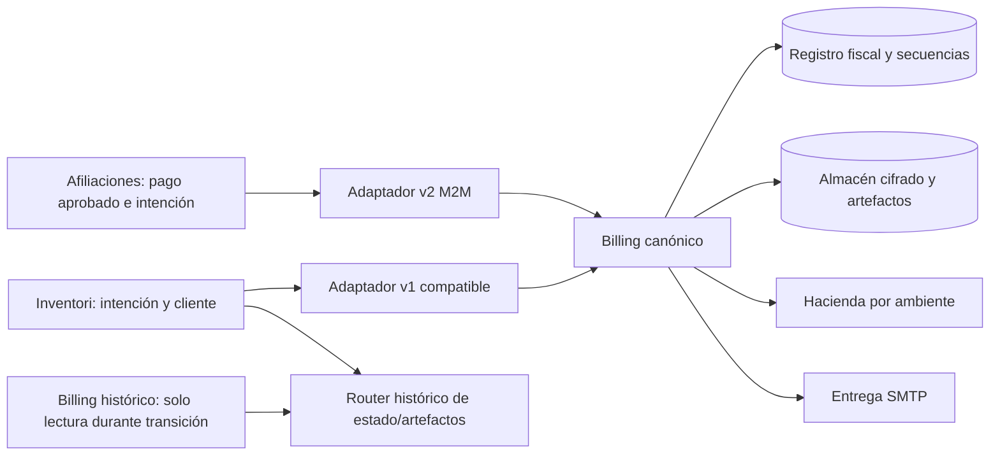

# Arquitectura objetivo

## Propiedad y límites

Un despliegue lógico de Billing mantiene registro canónico de emisores, P12/PIN, credenciales Hacienda, actividades, puntos de emisión, consecutivos, XML firmado, respuesta fiscal, PDF y entregas. Inventori y Afiliaciones conservan sus clientes, facturas comerciales, membresías/pagos e intenciones; envían un snapshot inmutable de receptor, líneas, impuesto, período y destino de correo, con identidad M2M por empresa y ambiente. Billing valida autorización y retorna identidad fiscal, estado y artefactos. Solo Billing llama a Hacienda y SMTP.

La convergencia **no implica** fusionar automáticamente PostgreSQL. Durante la transición, cada documento histórico queda en su Billing de origen y el router de lectura lo conserva por `billingInstanceId + fiscalDocumentId`. La emisión nueva solo se asigna a una instancia después de conciliar emisor, secuencias, claves, secretos, backups y relaciones. Nunca reescribir claves, consecutivos, XML ni estados históricos. Si dos instancias contienen el mismo emisor/ambiente, bloquear nuevo alta hasta decidir secuencia única y próxima numeración.

## Contrato propuesto (no endpoint implementado)

| Operación | Solicitud mínima | Respuesta/guardas |
| --- | --- | --- |
| Crear factura | Empresa/ambiente; snapshot fiscal completo; `Idempotency-Key`; hash versionado; correlación | `documentId`, clave/consecutivo asignados una vez; autorización de empresa y scope `invoices:create`; rechazar hash distinto con misma llave. |
| Preparar | `documentId` | XML/XSD/firma/huella; no exponer PIN ni P12. Puede quedar interno a Billing en contrato unificado. |
| Enviar | `documentId`, modo explícito SANDBOX/PRODUCTION | Scope `invoices:submit`, readiness y guardas de ambiente; exactamente una publicación de trabajo. HTTP de la API local no equivale al de Hacienda. |
| Consultar estado | `documentId` o identidad inmutable | Estado técnico y fiscal separados; `ACCEPTED` solo ante respuesta oficial concluyente. |
| Artefactos/entrega | `documentId`, autorización de consulta o reenvío | PDF, XML firmado, respuesta; evidencia de SMTP y resultado incierto separados. |
| Reconciliar | `documentId` bajo política de conflicto | GET fiscal controlado, auditado y con límites; nunca POST implícito. |

La implementación debe mapear estos conceptos a los **endpoints reales v1/v2**, sin inventar rutas en consumidores. Mantener v1 de Inventori y v2 de Afiliaciones en adaptadores finos hasta tener pruebas de paridad. Las claves M2M tienen scopes mínimos y vínculo activo empresa/ambiente; una clave de onboarding no concede emisión. Una operación humana extraordinaria como reenvío manual usa la identidad administrativa existente y auditoría, sin introducir una contraseña Billing obligatoria para cada factura.

La activación SANDBOX y producción tendrá gates separados. La factura SPEC-09 en revisión manual se excluye de cualquier reconciliación automática o migración mutante.
